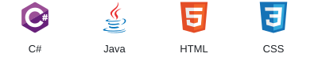

## Contributions

## Hi, I'm Arda.

I'm learning software development with the goal of becoming a backend developer.

I build projects to improve my programming skills, understand how software works, and turn ideas into useful tools.

## Skills

## Projects I write myself

Projects I code by hand while learning and improving my programming skills.

### [Campus Budget CLI](https://github.com/ardazeybek/campus-budget-cli)

A command-line budgeting tool for students to track income and expenses.

## Projects built with AI

Projects built with AI assistance. I shape the idea, features and design, and test the results.

AI-generated code is not presented as code I wrote entirely by hand.

### [Devlog](https://github.com/ardazeybek/devlog)

A VS Code extension for tracking coding time, activity and daily goals.

[Repository](https://github.com/ardazeybek/devlog) · [VS Code Marketplace](https://marketplace.visualstudio.com/items?itemName=ardazeybek.devlog-coding-activity)

## Find me

Email: [quantastudio.dev@gmail.com](mailto:quantastudio.dev@gmail.com)

[Instagram](https://www.instagram.com/azeybek_dev/) · [TikTok](https://www.tiktok.com/@azeybek_dev) · [Reddit](https://www.reddit.com/user/azeybek_dev/)
