

  I'm learning software development to become a <b>backend developer</b>. 
  I build small, useful tools to understand how software really works.

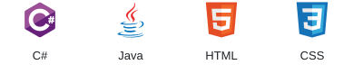

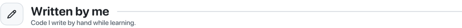

<a href="https://github.com/ardazeybek/campus-budget-cli">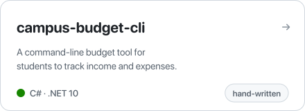</a> 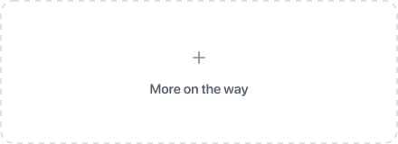

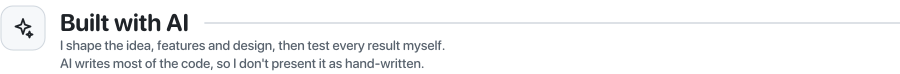

<a href="https://github.com/ardazeybek/clipio">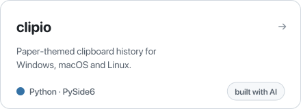</a> <a href="https://github.com/ardazeybek/devlog">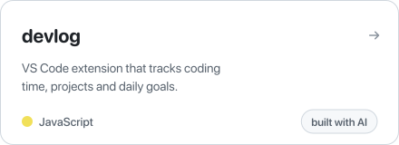</a>

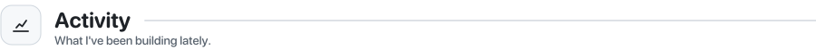

<a href="mailto:quantastudio.dev@gmail.com">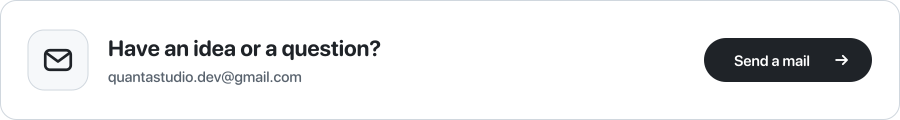</a>

  <a href="https://www.instagram.com/azeybek_dev/">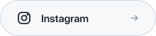</a>
  <a href="https://www.tiktok.com/@azeybek_dev">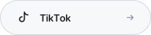</a>
  <a href="https://www.reddit.com/user/azeybek_dev/">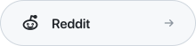</a>

