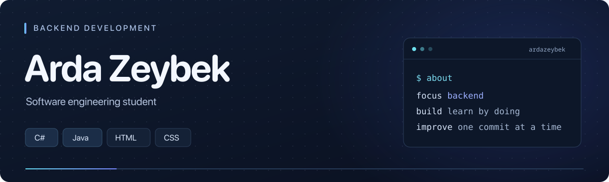

## About me

I'm **Arda**, a software engineering student working toward **backend development** with **C#** and **Java**. I learn by building practical projects, reviewing my code, and improving it step by step.

## Technologies

**Programming:** `C#` · `Java`  
**Web:** `HTML` · `CSS`

## Featured work

### [Campus Budget CLI](https://github.com/ardazeybek/campus-budget-cli)

A console application for student budgeting, built with **C# and .NET 10**.

- Records income and expenses across six spending categories.
- Shows the current balance and a budget summary.
- Simulates planned expenses without changing the actual balance.

**Next steps:** improve code structure and input validation, add JSON persistence, and introduce automated tests.

[Explore the code and setup guide →](https://github.com/ardazeybek/campus-budget-cli#readme)

## Current focus

- Strengthening my C# and Java foundations.
- Improving the structure and reliability of Campus Budget CLI.
- Building toward backend development through hands-on practice.
