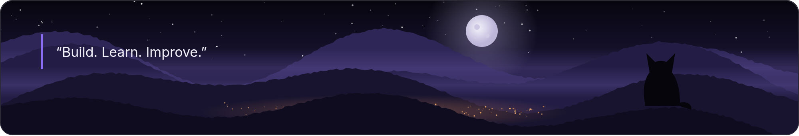

<a href="mailto:quantastudio.dev@gmail.com">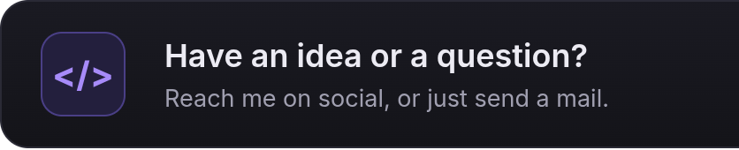</a><a href="https://www.instagram.com/azeybek_dev/">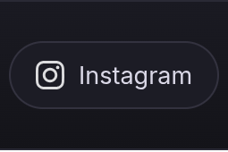</a><a href="https://www.reddit.com/user/azeybek_dev/">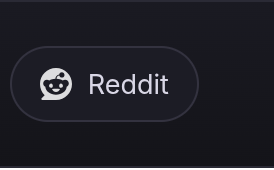</a>

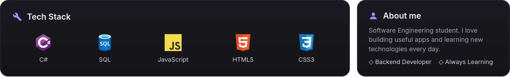

 

<a href="https://github.com/ardazeybek/campus-budget-cli">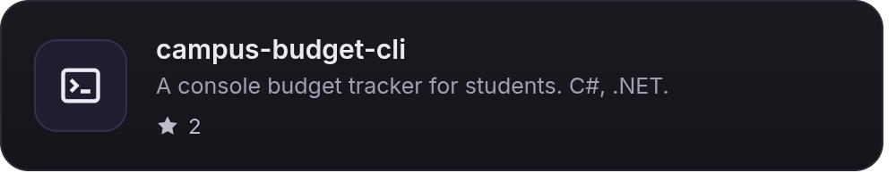</a>

<a href="https://github.com/ardazeybek/last-token">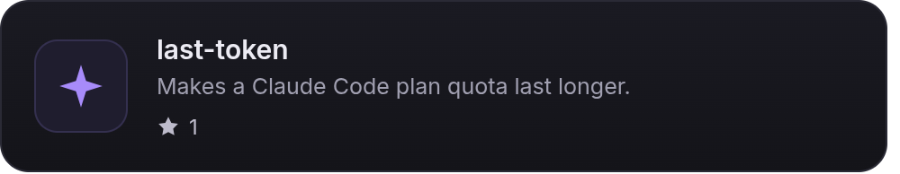</a><a href="https://github.com/ardazeybek/clipio">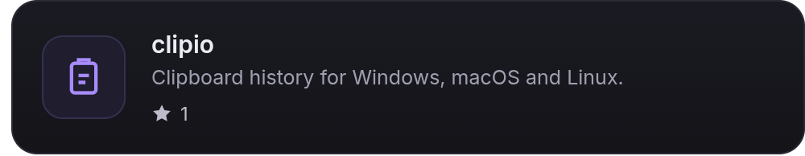</a> <a href="https://github.com/ardazeybek/devlog">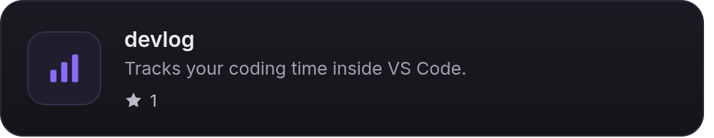</a>

<a href="https://github.com/erkamyaman/rust-anything/pulls?q=is%3Apr+author%3Aardazeybek+is%3Amerged">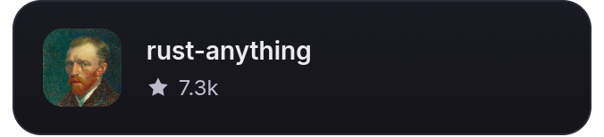</a><a href="https://github.com/Gathin23/cleanyourtv/pulls?q=is%3Apr+author%3Aardazeybek+is%3Amerged">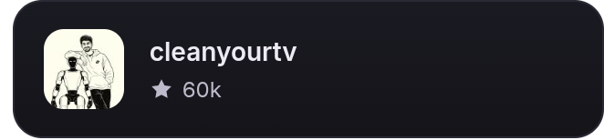</a> 

