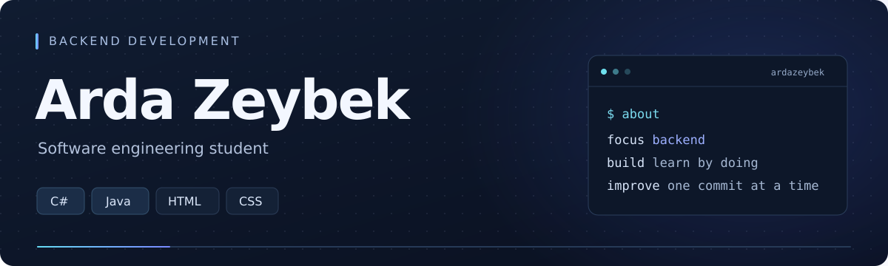

  

  <a href="https://github.com/ardazeybek?tab=repositories"><strong>Projects</strong></a>&nbsp; · &nbsp;
  <a href="https://www.instagram.com/azeybek_dev/">Instagram</a>&nbsp; · &nbsp;
  <a href="https://www.tiktok.com/@azeybek_dev">TikTok</a>&nbsp; · &nbsp;
  <a href="https://www.reddit.com/user/azeybek_dev/">Reddit</a>

### A little about me

I'm Arda, a software engineering student working toward **backend development** with **C#** and **Java**. I also work with **HTML** and **CSS** as I learn to build for the web.

This is where I share small tools, learning projects, and the improvements I make along the way.

### Languages I'm working with

  &nbsp;&nbsp;&nbsp;
  &nbsp;&nbsp;&nbsp;
  &nbsp;&nbsp;&nbsp;
  

**HTML · CSS · Java · C#**

### Things I've shared

<table>
<tr>
<td width="50%" valign="top">
<h3>01 &nbsp; Devlog</h3>

A free VS Code extension for seeing active coding time, daily goals, languages, and streaks in a local dashboard.

<strong>Developer tools · Local data · Open source</strong>

<a href="https://github.com/ardazeybek/devlog">Explore the repo →</a> <a href="https://marketplace.visualstudio.com/items?itemName=ardazeybek.devlog-coding-activity">Install for VS Code →</a>

</td>
<td width="50%" valign="top">
<h3>02 &nbsp; Campus Budget CLI</h3>

A student budgeting app for recording income and expenses, reviewing a budget, and trying out planned expenses.

<strong>C# · .NET · Command line</strong>

<a href="https://github.com/ardazeybek/campus-budget-cli">Explore the repo →</a>

</td>
</tr>
</table>

### Currently learning

- C# and Java fundamentals, with a focus on backend development.
- HTML, CSS, and how web interfaces fit together.
- Clearer code, better input checks, saved data, and tests.

<strong>About how I build these projects</strong>

 

**Campus Budget CLI** is a project I write by hand while learning.

**Devlog** started with AI-generated code. I shaped the idea, features, and design, and I'm learning to understand and maintain it myself. The repository explains how AI was used.

---

**Have an idea or spotted a bug?** Open an issue on the project — feedback and contributions are welcome.
