<picture><source media="(prefers-color-scheme: light)" srcset="assets/hero-light.png">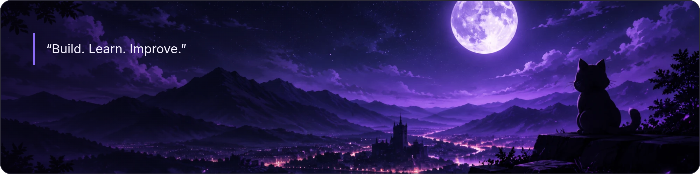</picture>

<a href="mailto:quantastudio.dev@gmail.com"><picture><source media="(prefers-color-scheme: light)" srcset="assets/contact-main-light.png">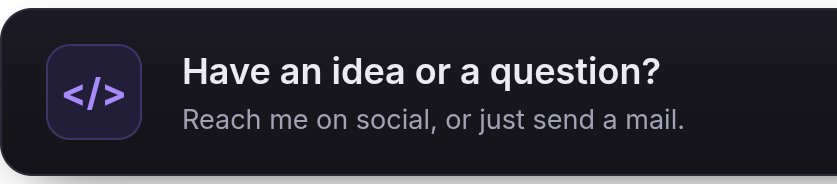</picture></a><a href="https://www.instagram.com/githubcat/"><picture><source media="(prefers-color-scheme: light)" srcset="assets/contact-ig-light.png">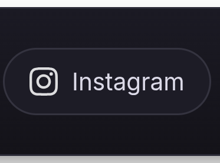</picture></a><a href="https://www.tiktok.com/@azeybek_dev"><picture><source media="(prefers-color-scheme: light)" srcset="assets/contact-tt-light.png">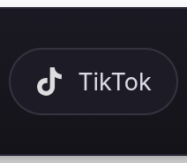</picture></a><a href="https://www.reddit.com/user/azeybek_dev/"><picture><source media="(prefers-color-scheme: light)" srcset="assets/contact-rd-light.png">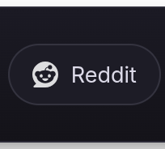</picture></a><a href="mailto:quantastudio.dev@gmail.com"><picture><source media="(prefers-color-scheme: light)" srcset="assets/contact-mail-light.png">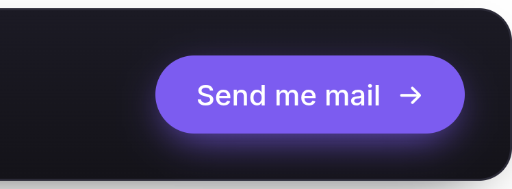</picture></a>

<picture><source media="(prefers-color-scheme: light)" srcset="assets/about-light.png">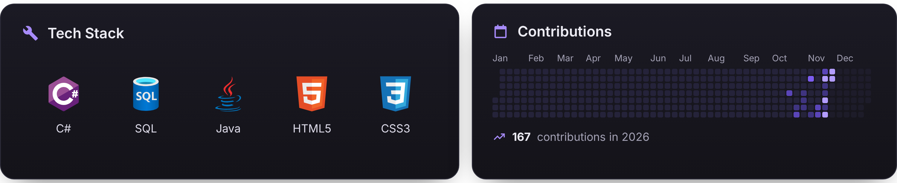</picture>

<picture><source media="(prefers-color-scheme: light)" srcset="assets/sec-pin-light.png"></picture>

<!--PINS:START-->

<a href="https://github.com/Gathin23/cleanyourtv"><picture><source media="(prefers-color-scheme: light)" srcset="assets/pin-1-light.png">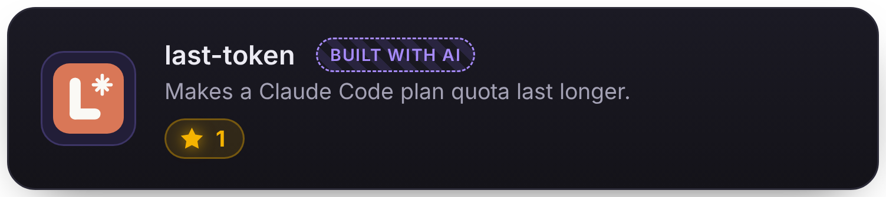</picture></a><a href="https://github.com/ardazeybek/last-token"><picture><source media="(prefers-color-scheme: light)" srcset="assets/pin-2-light.png">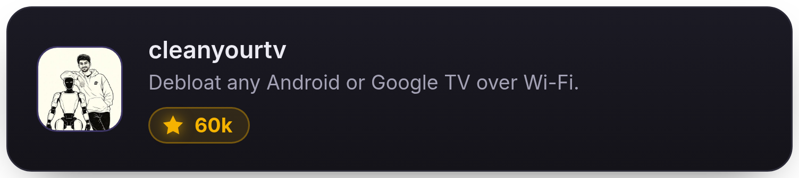</picture></a> <a href="https://github.com/hieunc229/mailflare"><picture><source media="(prefers-color-scheme: light)" srcset="assets/pin-3-light.png">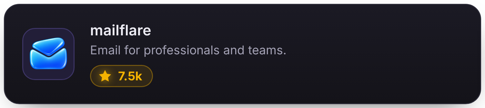</picture></a><a href="https://github.com/microsoft/skill-recorder"><picture><source media="(prefers-color-scheme: light)" srcset="assets/pin-4-light.png">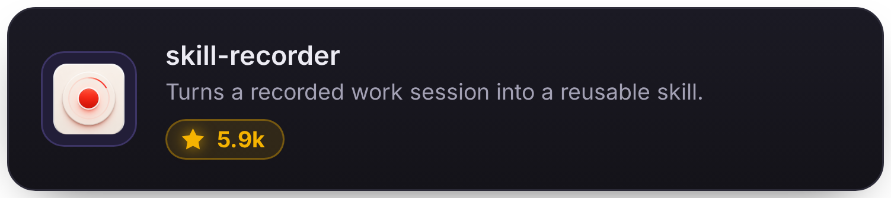</picture></a>

<!--PINS:END-->

<picture><source media="(prefers-color-scheme: light)" srcset="assets/sec-hw-light.png"></picture>

<a href="https://github.com/ardazeybek/campus-budget-cli"><picture><source media="(prefers-color-scheme: light)" srcset="assets/p-campus-light.png">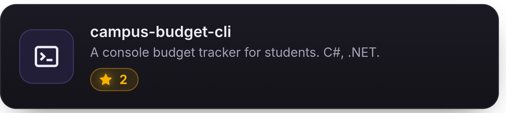</picture></a>

<picture><source media="(prefers-color-scheme: light)" srcset="assets/sec-ai-light.png"></picture>

<a href="https://github.com/ardazeybek/last-token"><picture><source media="(prefers-color-scheme: light)" srcset="assets/p-lt-light.png">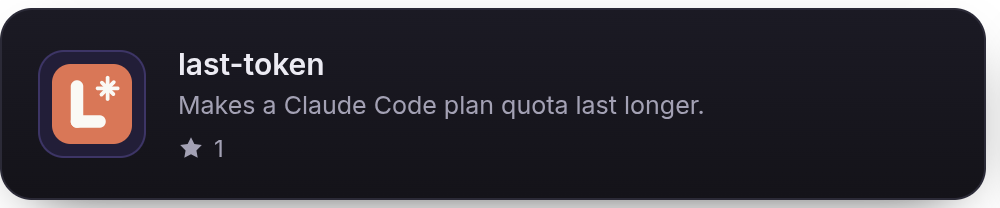</picture></a><a href="https://github.com/ardazeybek/clipio"><picture><source media="(prefers-color-scheme: light)" srcset="assets/p-clipio-light.png">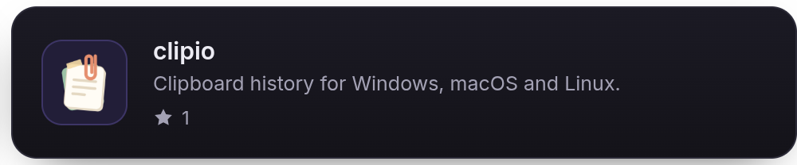</picture></a> <a href="https://github.com/ardazeybek/devlog"><picture><source media="(prefers-color-scheme: light)" srcset="assets/p-devlog-light.png">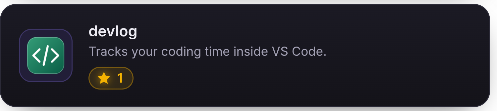</picture></a>

<picture><source media="(prefers-color-scheme: light)" srcset="assets/sec-co-light.png"></picture>

<a href="https://github.com/Gathin23/cleanyourtv/pulls?q=is%3Apr+author%3Aardazeybek"><picture><source media="(prefers-color-scheme: light)" srcset="assets/c-tv-light.png">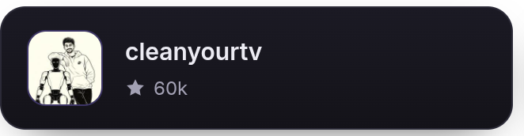</picture></a><a href="https://github.com/hieunc229/mailflare/pulls?q=is%3Apr+author%3Aardazeybek"><picture><source media="(prefers-color-scheme: light)" srcset="assets/c-mailflare-light.png">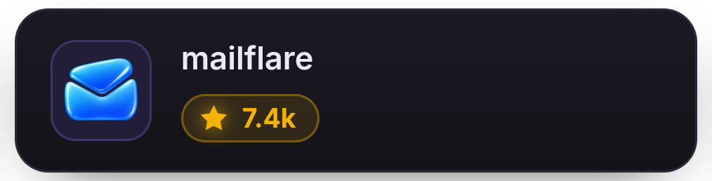</picture></a><a href="https://github.com/erkamyaman/rust-anything/pulls?q=is%3Apr+author%3Aardazeybek"><picture><source media="(prefers-color-scheme: light)" srcset="assets/c-rust-light.png">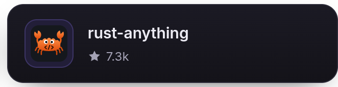</picture></a> <a href="https://github.com/microsoft/skill-recorder/pulls?q=is%3Apr+author%3Aardazeybek"><picture><source media="(prefers-color-scheme: light)" srcset="assets/c-skill-light.png">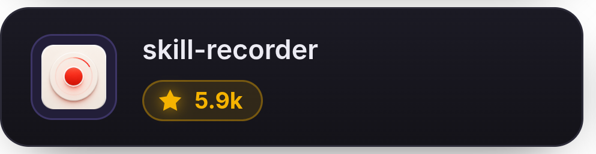</picture></a><a href="https://github.com/shanselman/gputaskman/pulls?q=is%3Apr+author%3Aardazeybek"><picture><source media="(prefers-color-scheme: light)" srcset="assets/c-gpu-light.png">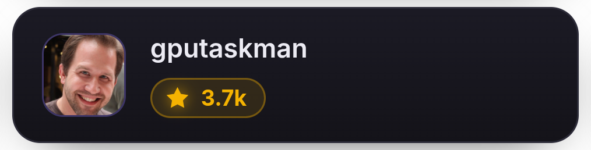</picture></a><a href="https://github.com/xevrion/hatchzip/pulls?q=is%3Apr+author%3Aardazeybek"><picture><source media="(prefers-color-scheme: light)" srcset="assets/c-hatch-light.png">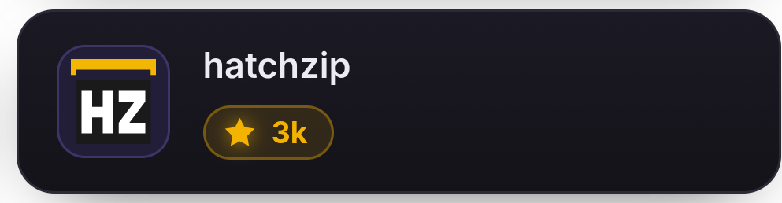</picture></a> <a href="https://github.com/FrigadeHQ/yogurt/pulls?q=is%3Apr+author%3Aardazeybek"><picture><source media="(prefers-color-scheme: light)" srcset="assets/c-yog-light.png">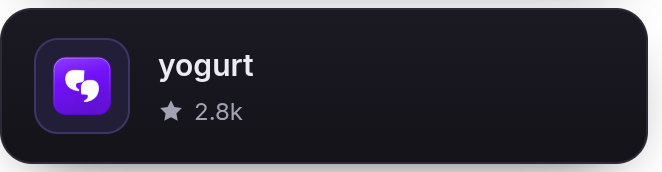</picture></a>

